<p align="center">
  
</p>

<p align="center">
  <a href="https://www.anypayx.com"></a>
  <a href="https://github.com/anypay/walletbot"></a>
  <a href="https://brew.sh"></a>
  <a href="https://github.com/anypay/homebrew-walletbot/blob/main/walletbot.rb"></a>
</p>

<p align="center">
  <a href="https://www.anypayx.com">Website</a> ·
  <a href="https://www.anypayx.com/docs">Docs</a> ·
  <a href="https://api.anypayx.com/api">API</a> ·
  <a href="https://www.anypayx.com/walletbot">WalletBot</a> ·
  <a href="https://github.com/anypay">GitHub</a> ·
  <a href="https://github.com/anypay/walletbot">WalletBot Source</a>
</p>

---

## What It Is &amp; Purpose

**homebrew-walletbot** is Anypay's official Homebrew tap for distributing WalletBot on macOS. It provides a single Ruby formula (`walletbot.rb`) that installs architecture-specific binaries (ARM64 and x64) of [WalletBot](https://github.com/anypay/walletbot) — Anypay's self-custody headless payment bot. WalletBot automates cryptocurrency payments by monitoring invoice webhooks and signing transactions directly from a local wallet, eliminating the need for hosted custodial services.

This tap simplifies WalletBot installation and upgrades for macOS users through Homebrew's standard package management workflow. It tracks GitHub releases of WalletBot and pulls pre-built native binaries from `anypay/walletbot/releases`, verifying integrity via SHA-256 checksums before installation.

## Why Use It

**homebrew-walletbot** is for merchants, developers, and power users who want **one-command installation** of WalletBot on macOS without manual binary downloads, path configuration, or permission fixes.

- **Who it's for:** macOS users running Anypay integrations, automated payment systems, or self-hosted checkout flows who need WalletBot available system-wide.
- **Where it fits:** This tap sits between the [WalletBot release pipeline](https://github.com/anypay/walletbot/releases) and local developer machines, acting as the official macOS distribution channel. It complements the core WalletBot npm package (`@anypay/walletbot`) for users who prefer native binaries over Node.js wrappers.

### Key Benefits

- **Verified binaries:** SHA-256 checksums enforce artifact integrity; malicious or corrupted downloads fail before installation.
- **Architecture awareness:** Homebrew automatically installs the correct binary (ARM or Intel) for your Mac.
- **System-wide access:** WalletBot lands in `/usr/local/bin` (or `/opt/homebrew/bin` on ARM), so it's immediately available in every terminal session.
- **Upgrade in place:** `brew upgrade walletbot` pulls the latest release when maintainers update the formula.
- **No build toolchain:** Pre-built binaries bypass Rust compilation, OpenSSL linkage, and other macOS dev environment pain.

## How It Works

<p align="center">
  
</p>

1. **brew tap anypay/walletbot** — User adds this repository to Homebrew's tap registry, registering `walletbot.rb` as an installable formula.
2. **Formula Resolve** — Homebrew reads `walletbot.rb`, which declares URLs for ARM and x64 binaries from the latest `anypay/walletbot` GitHub release (currently `v1.10.0`), plus SHA-256 checksums for verification. The formula inspects the CPU architecture and selects the matching download.
3. **WalletBot Binary** — Homebrew fetches the appropriate binary (`walletbot-macos-arm64` or `walletbot-macos-x64`), verifies its checksum, renames it to `walletbot`, and installs it into `bin/` with executable permissions.
4. **Automated Payments** — The installed `walletbot` binary monitors Anypay invoice webhooks, signs on-chain transactions using configured wallet keys, and broadcasts payments automatically — enabling self-custody settlement without manual intervention.

The formula maintainers update `BUILD_VERSION`, `ARM_SHASUM_256`, and `AMD_SHASUM_256` in `walletbot.rb` after each WalletBot release. Users then run `brew upgrade walletbot` to pull the latest version.

## Quickstart / How to Use It

### Prerequisites

- **macOS** (10.15 Catalina or later recommended)
- **Homebrew** installed ([brew.sh](https://brew.sh))
- **Internet access** to fetch binaries from GitHub

### Installation

Add the tap and install WalletBot:

```bash
brew tap anypay/walletbot
brew install walletbot
```

Verify the installation:

```bash
walletbot --version
```

**Expected output:** `v1.10.0` (or the current release version).

### Upgrading

When a new WalletBot release is published and this formula is updated:

```bash
brew upgrade walletbot
```

Homebrew checks for a newer formula, downloads the updated binary if available, verifies the checksum, and replaces the existing installation.

### Uninstalling

```bash
brew uninstall walletbot
brew untap anypay/walletbot
```

The first command removes the binary; the second removes this tap from your Homebrew configuration.

### Running WalletBot

After installation, `walletbot` is available in your `PATH`. Typical usage:

```bash
# Display help / available commands
walletbot --help

# Start WalletBot with a configuration file
walletbot start --config ~/.walletbot/config.json

# Monitor invoice webhooks and auto-pay
walletbot listen --webhook-url https://api.anypayx.com/webhooks/your-token
```

Refer to the [WalletBot documentation](https://www.anypayx.com/walletbot) and [source repository](https://github.com/anypay/walletbot) for configuration details, webhook setup, wallet key management, and production deployment patterns.

## Next Moves for Growth

This tap works reliably for its current purpose, but five high-leverage improvements would increase adoption, reduce maintenance friction, and align with Homebrew best practices:

1. **Automate formula updates on release.** The current workflow requires manual SHA-256 calculation and formula edits after each WalletBot release. Implement a GitHub Actions workflow in `anypay/walletbot` that opens a pull request to this tap whenever a new tag is pushed, automatically computing checksums via `shasum -a 256` and updating `walletbot.rb`. This eliminates the manual bottleneck and ensures the formula tracks releases within minutes.

2. **Publish to Homebrew core or cask.** Once WalletBot reaches stable 2.0 and has sustained usage, submit the formula to [Homebrew/homebrew-core](https://github.com/Homebrew/homebrew-core) for inclusion in the main tap. This removes the `brew tap` step entirely — users could install with `brew install walletbot` from day one. Requires meeting Homebrew's stability, documentation, and test coverage criteria, plus ongoing maintenance commitment.

3. **Add a `brew test do` block.** The current formula includes a minimal test (`system "#{bin}/walletbot", "--version"`), but it doesn't verify that WalletBot can actually start, load a config, or connect to a wallet. Expand the test to run `walletbot --help` and check exit codes, ensuring the binary isn't corrupted and core dependencies (OpenSSL, etc.) link correctly. This catches installation failures before users encounter them.

4. **Document the `get_release.sh` script or archive it.** The repository includes `get_release.sh`, which appears to be an unused/incomplete helper for fetching releases via the GitHub API. Either complete it as a maintainer tool (with instructions in a `MAINTAINERS.md` file) or remove it to avoid confusion. If the goal is automation, tie it into the GitHub Actions proposal above rather than keeping a standalone shell script.

5. **Add multi-platform support (Linuxbrew / Homebrew on Linux).** WalletBot builds for Linux, but this tap only declares macOS binaries. Extend `walletbot.rb` with `on_linux` blocks pointing to Linux ARM64 and x64 binaries if the upstream WalletBot releases include them. This lets Linux users on Debian, Ubuntu, and other distros install WalletBot via Homebrew without maintaining separate `.deb` / `.rpm` packages. Verify Linux binaries link correctly against system OpenSSL before publishing.

## Anypay Ecosystem &amp; License

**WalletBot Homebrew Tap** is part of [Anypay](https://www.anypayx.com) — Bitcoin &amp; Stablecoin payments for business. Merchants and developers use Anypay to accept BTC, ETH, and stablecoins such as USDC, USDT, RLUSD, and NUSD through invoices, APIs, SDKs, webhooks, WooCommerce, and mobile POS.

| Project | Role |
| --- | --- |
| [walletbot](https://github.com/anypay/walletbot) | Self-custody headless wallet for automated payments (`@anypay/walletbot`) |
| [anypay](https://github.com/anypay/anypay) | Invoice &amp; payments platform / API (`@anypay/server`) |
| [anypay-sdk](https://github.com/anypay/anypay-sdk) | TypeScript SDK for browser &amp; Node.js (`@anypay/client`) |
| [homebrew-walletbot](https://github.com/anypay/homebrew-walletbot) | Official Homebrew tap for WalletBot macOS distribution (this repository) |
| [anypayx.com](https://github.com/anypay/anypayx.com) | Marketing site, merchant dashboard, and developer docs |

### License

This repository (the Homebrew formula and tap infrastructure) does not include a `LICENSE` file. The distributed **WalletBot** binary is sourced from [anypay/walletbot](https://github.com/anypay/walletbot), which is licensed under the **MIT License** — permitting free use, modification, and distribution. The formula itself (`walletbot.rb`) is a thin packaging wrapper around WalletBot releases and follows standard Homebrew tap conventions.

For licensing questions specific to WalletBot usage or distribution, refer to the [WalletBot LICENSE](https://github.com/anypay/walletbot/blob/master/LICENSE) in the upstream repository.

---

<p align="center">
  <a href="https://www.anypayx.com"></a><br/>
  <sub>Bitcoin &amp; Stablecoin Payments For Business · <a href="https://www.anypayx.com">anypayx.com</a> · <a href="https://x.com/xanypay">@xanypay</a></sub>
</p>
